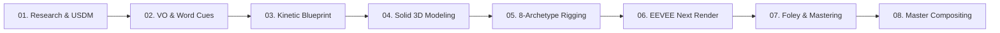

# 3D Semi-Real Explainer: Universal Production Standard & Framework

A battle-tested, industrial-grade framework for producing captivating vertical (9:16, $1080 \times 1920$, 30 FPS) technical explainer motion graphics using Blender 5.x EEVEE Next, VOLT Design System 1.1, and script-driven sound design.

Designed to be **Domain-Agnostic and Universally Scalable**: works across consumer hardware (*meso*), semiconductor/nanotechnology (*micro*), civil engineering/architecture (*macro*), celestial mechanics (*cosmic*), as well as everyday cultural/street and domestic phenomena.

---

## 1. Core Production Contract & Directives

1. **NO 2D Image Pans / Zooms:**
   - Every explainer must be produced from **true 3D sequential frames** with 3D camera travel in $X, Y, Z$, dynamic focal changes, and physical component deconstruction per frame.
2. **Semi-Realistic Aesthetic (Clean Tactile Engineering):**
   - **NO Cartoon Freestyle Outlines:** Strictly ban 2px black cartoon freestyle ink strokes.
   - **Closed Solid Manifolds:** Every sliced part must have authentic wall thickness and softened edges ($0{,}3\text{–}1{,}2\text{ mm}$ micro-bevels) to catch specular highlights.
   - **Tactile Materials:** Physical shaders (anodized matte, brushed SUS304, metallic mirrors, and Subsurface Scattering/SSS on elastomeric parts like silicone gaskets).
   - **Seamless Stage:** Warm-white (`#F4F1EA`) curved L-shaped infinity cyclorama with three-point studio lighting and dual rim lights.
3. **Pure VOLT Design System 1.1:**
   - **Typography:** True Arial / Helvetica Bold with tight negative letter-spacing (`-0.055em` to `-0.065em`) and line-height `0.95`.
   - **Modular Swiss Grid:** Crisp $1.5\text{–}2.0\text{ px}$ `#101110` solid borders, zero corner radius ($0\text{ px}$ sharp corners).
   - **The One Signal Principle:** Only the active component being discussed receives the `#E8F500` (*Electric Yellow*) highlight; secondary elements remain `#FFFFFA` (*Paper*).
   - **NO Drop Shadows:** Artificial black drop shadows and multi-colored rainbow ribbons are strictly forbidden.

---

## 2. Universal Systems Dynamics Matrix (USDM)

Before authoring 3D assets, the agent must perform a **Physical Dynamics Audit** across scale and domain:

### A. The 4 Spatial Scales
1. **Micro / Nano Scale (Molecules & Electronics):**
   - *Subjects:* Heat radiation, battery lithium ions, microchip logic gates, porous filters.
   - *Techniques:* Directional particle emitters, glowing energy pulses, internal tunneling fly-throughs.
2. **Meso Scale (Consumer & Mechanical Products):**
   - *Subjects:* Thermoses, smartphone mechanisms, mechanical watches, automotive brakes.
   - *Techniques:* Cross-section peeling, radial door slides, axial exploded components.
3. **Macro Scale (Structures & Civil Engineering):**
   - *Subjects:* Skyscrapers, suspension bridges, industrial factories, high-speed rail.
   - *Techniques:* Modular layer-by-layer assembly, static load vector arrows, tuned mass damper oscillation.
4. **Cosmic Scale (Astrodynamics & Planetary Science):**
   - *Subjects:* Earth rotation & revolution, seasonal sunlight angles, orbital mechanics.
   - *Techniques:* $23.5^\circ$ axial tilt lines, elliptical orbit trails, sharp terminator day/night line.

### B. The 6 Physical Dynamics Domains
The agent must identify and animate at least 2 of these dynamic domains:
* **Kinematics:** Revolute hinges, sliding tracks, gear meshes, spring recoil, thread tightening.
* **Thermodynamics:** Expanding infrared radiation waves, fluid convection currents, lattice conduction.
* **Fluid & Gas:** Pressure differentials ($P_1 > P_2$), vacuum suction, cavitation, boiling vapor bubbles.
* **Electromagnetism:** Electron drift, magnetic flux lines, RF emissions, circuit sparks.
* **Material Mechanics:** Gasket silicone compression, tensile strain, brake pad friction wear.
* **Barriers & Rebound:** Metal mirror reflection ($98\%$), acoustic dampening, membrane filtration.

> **Law:** *If the voiceover explains how a component works, that component MUST actively move/react on screen.*

---

## 3. The 8-Part Cinematic Camera Choreography & Speed Ramping

The agent must avoid monotonous linear camera movement. Every shot must map to one of the 8 archetypes:

```
[ THE SPEED RAMPING FORMULA ]
Fast Whip Entrance (0.20s - 0.25s)  ──►  Spring Cushion & Steady Hold (1.5s - 3.0s)  ──►  Fast Recoil Exit (0.30s)
```

| No | Archetype Name | Narrative Beat | Camera & Lens Settings | Easing & Motion Formula |
| :---: | :--- | :--- | :--- | :--- |
| **01** | **The Horizon Hook** | Hook (0.0s - 5.0s): Hero introduction | Low-angle tilt-up ($15^\circ\text{–}20^\circ$), crane up to mouth. Lens $35\text{–}50\text{ mm}$. | Smooth `ease_in_out` crane rise. |
| **02** | **The Whip-Punch** | Problem Transition: Directs focus to core flaw | Rapid push-in to micro gap. Lens zooms to $85\text{–}100\text{ mm}$ macro. | Whip in $0.25\text{s} \rightarrow$ Cushion settle with spring damping. |
| **03** | **The Orbit Slice** | Slicing / Peeling: Exposes 3D wall thickness | Sweeping orbit $30^\circ\text{–}45^\circ$ around cutaway plane. | Continuous rotational arc capturing rim light. |
| **04** | **The Micro-Dolly** | Micro Gap Inspection: Explores seals & channels | Narrow macro lens, shallow DoF. Constant tracking along boundary. | Ultra-stable constant tracking speed. |
| **05** | **The Tunneling** | Internal Channel: Penetrates tube/orifice | Camera plunges through orifice into fluid chamber. | Acceleration in $\rightarrow$ Deceleration inside cavity. |
| **06** | **The Dynamic Dutch** | Mechanical Action: Spring snap, explosion, shock | High-angle $45^\circ$ macro looking down + Dutch tilt $10^\circ\text{–}15^\circ$. | Kinetic shake ($0.05\text{s}$) on physical impact. |
| **07** | **The Telemetry Lock** | Data Proof: Metric card display | Camera locks **100% DEAD STEADY (zero wobble)** on right third. | Static position, zero drift for maximum legibility. |
| **08** | **The Snap-Out Recoil** | Outro Loop: Object returns to initial state | Rapid pull-out ($0.35\text{s}$) matching component lock. | Snappy deceleration, seamless match to Frame 0. |

---

## 4. Adaptive Semantic Sensory Typography (Kinetic Badges)

The agent must parse the script for sensory and narrative context and dynamically generate kinetic onomatopoeia/status badges:
1. **Mechanical & Tactile:** `[ KLIK! ]`, `[ SNAP ]`, `[ KUNCI RAPAT ]` (Electric yellow `#E8F500` box, spring scale pop $1.35\times \rightarrow 1.0\times$).
2. **Invisible Physics & Telemetry:** `[ HAMPA VAKUM // 0 MOLEKUL ]`, `[ 98% REFLEKSI ]` (Black `#101110` inversion box, implosion squeeze).
3. **Everyday Street & Domestic Acoustics:** `[ PRIT PRIT! ]`, `[ TIIIN! ]`, `[ BLEBEK-BLEBEK! ]`, `[ NGIIIIING! ]` (Staccato double-pulse, steam vibration).
4. **Digital & Interface:** `[ TRING! ]`, `[ 1 PESAN MASUK ]`, `[ SYNCED ]` (Sharp top-screen spring pop).

---

## 5. Conditional Labeling Protocol

* **Creative Autonomy:** Pin annotation cards are **CONDITIONAL**, not mandatory on every frame. When visual awe, particle turbulence, or internal tunneling takes center stage, labels must be omitted (*Zero Visual Clutter Rule*).
* **Execution Standard when Active:**
  1. *Leader Line Draw ($0.15\text{s}$):* Elbow line draws from 3D tracking anchor to card.
  2. *Card Spring Pop ($0.20\text{s}$):* Box expands with spring physics (`scale 0.85 -> 1.08 -> 1.0`).
  3. *One Signal:* Active component in `#E8F500`, inactive in `#FFFFFA`.
  4. *Automatic Suppression:* Labels automatically deactivate during metric proof segments.

---

## 6. Sound Mapping Protocol (SMP) & Loudness Mastering

1. **Layer Hierarchy:**
   - **Voiceover (VO):** Center lead, crystal clear.
   - **Foley Physical Layer ($-12\text{ dB}$):** Mechanical snaps, pneumatic whooshes, metal pings, whistles.
   - **Atmospheric Layer ($-16\text{ dB}$):** Vacuum hum, wind shear, deep thermal rumblings.
   - **Sub-Bass Impact ($-14\text{ dB}$):** $75\text{–}85\text{ Hz}$ drop on key proof numbers.
2. **Mastering Standard (EBU R128):**
   - When mixing with FFmpeg `amix`, ALWAYS pass `normalize=0:dropout_transition=0` to prevent VO attenuation.
   - Normalize the final audio to **$-14\text{ LUFS}$** (True Peak $-1.0\text{ dBFS}$) via `loudnorm=I=-14:TP=-1.0:LRA=7`.

---

## 7. Data-Driven 3-Beat Metric Punch

For presenting empirical test proof (e.g., JIS standards, temperature retention, PSI, efficiency):
1. **Beat 1 - Spring Entrance ($0.2\text{s}$):** Modular 3-grid card slides in from screen bottom with spring recoil.
2. **Beat 2 - Digit Scale Punch ($0.4\text{s}$):** Primary proof metric (e.g., `≥ 71°C`) pops to **$1.35\times$** and settles back as the voiceover speaks the number.
3. **Beat 3 - Signal Flash ($0.1\text{s}$):** Border or container glows with an electric yellow pulse confirming data validation.

---

## 8. Automated Production Pipeline (8 Steps)



1. **Step 01 - Research & USDM:** Extract 1:1 physical dimensions, test data, and classify 6 physical dynamic domains.
2. **Step 02 - Narration VO & Cues:** Record/synthesize VO and generate millisecond-accurate SRT word cues.
3. **Step 03 - Kinetic Blueprint:** Map the 8 camera archetypes to the VO timeline, define conditional label intervals, and script kinetic badges.
4. **Step 04 - Solid 3D Modeling:** Build closed-manifold solids with bevels, SSS shaders, and curved infinity cyclorama in Blender.
5. **Step 05 - Rigging & Speed Ramping:** Setup camera with `TRACK_TO` constraints, animate physical components (hinges, peeling, radiation waves), and export 3D-to-2D tracking anchors JSON.
6. **Step 06 - Sequential 3D Rendering:** Render 1680 frames @ 30 FPS via Blender EEVEE Next (target $\le 1.5\text{s}$/frame).
7. **Step 07 - Foley Sound Design:** Synthesize foley audio, mix with VO, and master to $-14\text{ LUFS}$ broadcast loudness.
8. **Step 08 - Master Compositing:** Composite 3D frames with dynamic VOLT DS headers, kinetic badges, spring labels, metric punch, and karaoke subtitles into high-profile MP4.
