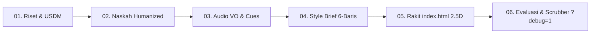

# Poro Web Explainer: Universal 2.5D Web-Native Production Framework

Framework produksi motion graphics teknis dan eksplanasi sains industri berbasis **Web Native (HTML5 + CSS + SVG + GSAP)**. Menggabungkan arsitektur deterministik web Bang Motion dengan ketajaman estetika resmi **Poro Local (2.5D Isometric Flat Vector, Palet Paper/Lime/Ink, Space Grotesk)** dan rigoritas sains **USDM (Universal Systems Dynamics Matrix)**.

Output final berupa **satu file `index.html`** yang memutar video secara mulus (autoplay, loop, audio sync, scrubber `?debug=1`, dan siap diekspor frame-by-frame ke MP4 tanpa ketergantungan render 3D berat).

---

## 1. Identitas Visual Poro Local (Design Tokens & Kontrak Estetika)

### A. Palet Warna Terkunci (CSS Design Tokens)
Semua elemen, stroke, fill, dan kartu data wajib merujuk ke token ini di `:root`:

```css
:root {
  /* Latar & Pijakan Kanvas */
  --poro-paper:   #FAFAFF;  /* Latar kanvas utama (Kertas terang bersih) */
  --poro-ground:  #E3E7F2;  /* Platform isometrik tempat objek/mekanisme berpijak */
  
  /* Garis Kontur & Tipografi */
  --poro-ink:     #141D3F;  /* Warna kontur utama, teks headline, border solid 1.5-2px */
  
  /* Struktur Mekanikal & Layer Pendukung */
  --poro-navy:    #344773;  /* Struktur bodi mekanik, rangka internal, cangkang */
  --poro-mid:     #64769B;  /* Garis leader penunjuk label, shading sekunder */
  
  /* Aksen Sinyal Tunggal (The Poro Focus) */
  --poro-focus:   #D1FF30;  /* ELECTRIC LIME — satu-satunya pemicu atensi aktif! */
  
  /* Aksi Dinamika Fisika (Fungsional USDM) */
  --poro-heat:    #E67E22;  /* Kawat nikrom membara, radiasi termal Joule */
  --poro-cool:    #38BDF8;  /* Aliran fluida dingin, hisapan udara, ruang hampa */
}
```

### B. Geometri 2.5D Isometrik (Faceted Shading)
Dilarang menggunakan tekstur fotorealistis kotor atau efek plastik mainan (*glossy toy*). Semua model mekanikal diwujudkan dengan **vektor isometrik/ortografik 3-bidang**:
1. **Bidang Atas (Top Plane):** Warna base $+ 15\%$ lightness (atau `#FAFAFF`).
2. **Bidang Kanan (Right Plane):** Warna base murni (`--poro-navy`).
3. **Bidang Kiri / Bawah (Left Plane):** Warna base $- 25\%$ lightness (bayangan).
4. **Kontur Tegas (Crisp Outline):** Setiap komponen dibungkus garis tepi $1.5\text{--}2.0\text{ px}$ `--poro-ink` (`#141D3F`).

### C. Tipografi Resmi
* **Headline & Sub-Headline:** `Space Grotesk` (Bobot 600 Semi-Bold & 700 Bold, tracking `-0.02em`).
* **Data, Angka Metrik & Telemetri:** `JetBrains Mono` / `Space Mono` (Tabular figures).

### D. Kepatuhan Safe Zone Multi-Platform & Full-Bleed Canvas (9:16 - 1080x1920)
1. **Full-Bleed Canvas (Layar Wajib Penuh & Padat):**
   - Lingkungan (*environment*), rel kereta, jalanan aspal, pipa fluida, dan partikel atmosfer **WAJIB mengisi seluruh frame $1080 \times 1920$ secara penuh (Full-Bleed)**. Dilarang menciutkan seluruh dunia ke dalam kotak kecil sehingga layar tampak kopong.
2. **Essential Safe Zone Locking (Penguncian Elemen Kritis):**
   - Elemen yang **DILARANG KELUAR** dari zona aman ($X: 110\text{--}900\text{ px}$, $Y: 270\text{--}1400\text{ px}$) hanyalah:
     - **Titik Fokal Aksi / Kontak Mekanik:** Titik sentuh roda-rel, celah gasket silikon, katup pembuka.
     - **Tipografi Penting:** Headline judul, badge status sensori, kartu callout teknis.
     - **Kartu Metrik & Angka Pembuktian Uji.**
3. **Subtitle Safe Zone:**
   - Subtitle wajib berada di zona $X: 110\text{--}900\text{ px}$, $Y: 1200\text{--}1400\text{ px}$ (bebas dari gangguan tombol sosmed di kanan dan caption deskripsi di bawah).

### E. Rigid Mathematical Isometric & Ellipse Projection
Untuk menjaga keakuratan bentuk teknis (roda, puli, silinder, pipa) agar tidak tampak penyok atau sembarangan:
1. **Rasio Sumbu Elips Isometrik ($1 : \sqrt{3}$):**
   - Setiap lingkaran horizontal yang diproyeksikan ke dalam bidang isometrik ($30^\circ$) wajib memiliki rasio matematis presisi:
     $$\frac{\text{Sumbu Minor}}{\text{Sumbu Mayor}} = \sin(35{,}264^\circ) \approx 0{,}577$$
   - Dilarang menggambar elips mekanis dengan rasio sembarangan.
2. **Continuous Action Relative Motion (Kamera Mengunci Titik Fokal):**
   - Pada kasus objek bergerak (kereta melaju di rel, mobil meluncur di aspal, fluida mengalir di pipa):
     - **Objek Hero (Roda/Mesin):** Posisinya terkunci relatif terhadap kamera di area *sweet spot* tengah layar.
     - **Lingkungan (Rel/Jalanan/Tanah):** Mengalir deras di bawah/belakangnya melalui sistem looping parallax berkecepatan $D(t)$.
     - **Dynamic Macro Zoom:** Saat penjelasan teknis masuk, kamera melakukan zoom $1{,}8\times\text{--}2{,}2\times$ tepat ke titik kontak mekanis tanpa menghentikan kelajuan aliran dunia di belakangnya.

### F. Hukum Anti-Skematik Lidi (Anti-Wireframe Law) & Heavy-Gauge Primitives
Model AI secara alami akan jatuh ke jalan pintas menggambar skema rangkaian lidi murahan jika tidak dicegat dengan aturan fisik ini:

1. **Haram Garis Lidi ($\le 4\text{ px}$ pada Komponen Mekanik):**
   - Dilarang keras menggambar selang rem, kabel hidrolis, pipa, atau batang logam dengan garis lidi tipis $1\text{--}3\text{ px}$.
   - **Selang Hidrolis / Pipa:** Wajib berupa `<path>` tebal $\ge 12\text{--}14\text{ px}$ dengan kurva bezier luwes + garis pendar kilap (highlight) $3\text{--}4\text{ px}$ di tengahnya.
   - **Batang Logam / Stang / Poros:** Wajib berdiameter $\ge 24\text{--}36\text{ px}$ dengan **Shader Gradien 3-Stop Cylindrical Metallic**:
     ```html
     <linearGradient id="metalShaft" x1="0" y1="0" x2="1" y2="0">
       <stop offset="0%" stop-color="#141D3F"/>   <!-- Bayangan tepi -->
       <stop offset="45%" stop-color="#E2E8F0"/>  <!-- Kilap specular tengah -->
       <stop offset="100%" stop-color="#0F172A"/>  <!-- Bayangan tepi -->
     </linearGradient>
     ```
2. **Haram Kotak Bagan Flowchart & Segitiga Garis:**
   - Dilarang membuat komponen mekanik berupa kotak garis tipis berisi teks atau segitiga kaku ala bagan listrik.
   - **Tuas & Equalizer:** Wajib digambar sebagai **lengan ayun mekanis padat (*solid rocker arm*)** berkontur tegas dengan lubang baut poros (*bushing pin*) silindris di tengahnya. Saat kabel primer ditarik, lengan ayun harus berotasi fisik dan menekan piston sekunder.
   - **Master Cylinder & Kaliper:** Wajib berupa balok berbobot solid (*faceted bevel box*) dengan tangki reservoir minyak rem mini transparan di atasnya.
3. **Hukum Anti-Miniatur (Close-Up Frame Fill $50\text{--}65\%$):**
   - Komponen utama yang sedang dibedah (misal: stang dan master rem CBS) **wajib mengisi $50\text{--}65\%$ tinggi layar**.
   - Dilarang meletakkan objek kecil seukuran ibu jari yang mengambang di tengah ruang kosong.
   - Stang/handlebar motor wajib memotong layar penuh secara horizontal (*full-bleed edge-to-edge*).
4. **Wadah Ruang Mesin / Chassis Enclosure:**
   - Mekanisme internal tidak boleh melayang aneh di udara kosong. Selalu bungkus mekanisme di dalam wadah chassis ber-border solid (`rx="24--36px"` dengan latar gelap berkontras atau pendar visual), memberikan ilusi kita sedang mengintip ke balik bodi motor.

### G. Standar Anatomi Objek Nyata (Anti-Halu Bentuk) & Checklist 5 Fitur Khas
AI dilarang menggambar objek kendaraan atau hardware sebagai balok polos atau kubus generik. AI wajib mengaudit proporsi fisik dan memodelkan siluet aslinya:

1. **Rasio Dimensi Fisik Baku ($L : W : H$):**
   - Objek kendaraan/mesin wajib mematuhi proporsi nyata (misal: Bus Kota modern $12\text{m} \times 2{,}5\text{m} \times 3{,}2\text{m} \rightarrow$ rasio panjang-ke-tinggi $\approx 3{,}75 : 1$). Dilarang membuat bus pendek bantet seperti kubus mainan.
2. **Checklist Wajib 5 Fitur Karakteristik (Untuk Kendaraan):**
   - **Pilar Kaca Depan Aerodinamis:** Kaca depan miring melengkung ($15^\circ\text{--}20^\circ$ sudut aerodinamis), bukan bidang tegak kotak sepatu.
   - **Pod AC Atap Bervolume (Rooftop HVAC Unit):** Kompartemen ber-gril kisi udara di atap belakang (tempat antena GNSS menempel).
   - **Rumah Roda Melengkung (Fender Archs):** Lekukan spakbor di atas ban dengan pelek radial ber-bevel.
   - **Spion Tanduk Ganda (Elephant-Ear Side Mirrors):** Ciri khas visual utama kendaraan komersial modern.
   - **Fascia Bumper Depan:** Lampu proyektor LED ganda, gril radiator bawah, dan garis lekukan pintu lipat penumpang.
3. **Kewajiban Referensi Model di Style Brief:**
   - Di Style Brief, AI wajib menyebutkan model spesifik yang ditiru (contoh: *City Bus Low-Deck Mercedes-Benz Citaro / Skylander*).

### H. Zonasi Spasial Vertikal (Aturan Anti-Teks Overlap & Clutter)
Untuk mencegah teks saling menabrak dan menjaga keterbacaan $100\%$ di layar HP vertikal $1080 \times 1920$:

1. **Zona Atas ($Y: 220\text{--}480\text{ px}$):**
   - Eksklusif HANYA untuk Kicker Tag, Headline, Sub-headline, & Sensory Badge tunggal.
2. **Zona Tengah ($Y: 480\text{--}1200\text{ px}$):**
   - Area khusus ilustrasi 2.5D objek dinamis & garis leader callout teknis.
3. **Zona Bawah ($Y: 1220\text{--}1400\text{ px}$ - Mutually Exclusive):**
   - **PILIH SALAH SATU:** Saat Subtitle aktif, Kartu Metrik wajib disembunyikan. Saat Kartu Metrik aktif meletup ($1{,}35\times$), Subtitle wajib meredup/turun. Dilarang keras menumpuk keduanya di area yang sama!
4. **Aturan Badge Sensori Tunggal & No-Wrap:**
   - Dilarang memunculkan $> 1$ badge sensori sekaligus. Badge lama wajib fade-out sebelum badge baru melompat ke layar. Wajib menyertakan `white-space: nowrap;` agar badge tidak tertekuk menjadi kotak bertingkat.

### I. Hukum Pemisahan Layer DOM: `#hud-layer` vs `#world` Camera Rig
Untuk mencegah bencana visual di mana headline ikut membesar $200\%$ dan terpotong saat kamera melakukan zoom macro:

1. **Haram Menaruh Teks Headline & Subtitle di dalam `#world`:**
   - `<div id="world">` HANYA berisi elemen fisik yang terkena pergerakan kamera (SVG dunia 2.5D, jalanan raya, bodi kendaraan, callout anchor).
2. **Layer Tetap (`#hud-layer`) Wajib di Luar `#world`:**
   - Semua elemen HUD editorial (Headline, Kicker, Subtitle, Metric Card) wajib dibungkus dalam `<div id="hud-layer">` yang menempel langsung pada `#stage` dengan `pointer-events: none; z-index: 100;`.
   - Ketika kamera GSAP melakukan zoom $1{,}8\times$ atau tilt pan pada `#world`, seluruh teks HUD tetap $100\%$ stabil, tajam, dan terkunci rapi di Essential Safe Zone.
3. **Flexbox Natural Flow pada Top Narrative:**
   - Wadah `.top-narrative` wajib menggunakan `display: flex; flex-direction: column; align-items: flex-start; gap: 12px;` tanpa fixed height, sehingga headline 2-baris atau sub-headline panjang otomatis mengalir ke bawah tanpa menimpa sensory badge.

---

## 2. Universal Systems Dynamics Matrix (USDM) & Riset Empiris

Sebelum menulis naskah atau kode visual, AI wajib melakukan audit terhadap skala dan minimal 2 domain dinamika fisika:

### A. 4 Skala Spasial
1. **Mikro / Nano:** Radiasi infra-merah, ion lithium, molekul udara, pori mikron $\rightarrow$ partikel emitter dinamis & penetrasi celah.
2. **Meso:** Produk mekanikal konsumen (termos, hair dryer, jam otomatis, rem) $\rightarrow$ pembelahan layer isometrik (*layer peel*) & urai sumbu (*axial exploded*).
3. **Makro:** Bangunan sipil, jembatan, gedung tinggi, transportasi publik $\rightarrow$ perakitan modular bertingkat + panah vektor gaya beban.
4. **Kosmik:** Rotasi bumi, kemiringan sumbu $23{,}5^\circ$, radiasi surya $\rightarrow$ garis poros & terminator siang/malam.

### B. 6 Domain Dinamika Fisika
AI wajib menganimasikan minimal 2 domain secara aktif:
* **Kinematika:** Roda gigi berputar, pegas melenting, ulir mengunci.
* **Termodinamika:** Radiasi termal memancar (`--poro-heat`), konveksi paksa fluida.
* **Fluida & Gas:** Perbedaan tekanan ($P_1 > P_2$), hisapan ruang vakum (`--poro-cool`), letupan gelembung.
* **Elektromagnetik:** Garis medan fluks, arus elektron, induksi kumparan.
* **Mekanika Material:** Kompresi elastis silikon/gasket, tegangan regangan, gesekan friksi.
* **Barier & Refleksi:** Pantulan cermin perak $98\%$, membran filter partikel.

> **Hukum USDM:** *Jika narasi menjelaskan cara kerja suatu komponen, komponen itu WAJIB bergerak/bereaksi secara fisik pada layar.*

---

## 3. Struktur Naskah 7-Tahap (Reverse Engineering Standard) & Seamless Infinity Loop

Naskah narasi adalah tulang punggung video. Setiap naskah wajib disusun mengikuti **7 Pilar Inti Bersama** hasil reverse engineering video terbaik:

### A. Alur Naskah 7-Tahap
```
[ 1. Pengalaman Sehari-hari ] ──► [ 2. Satu Pertanyaan Payung ] ──► [ 3. Hero Object Anchor ]
                                                                             │
┌────────────────────────────────────────────────────────────────────────────┘
▼
[ 4. Bedah Bagian demi Bagian ] ──► [ 5. Bukti Konkret/Data ] ──► [ 6. Jawaban Tuntas ]
                                                                             │
┌────────────────────────────────────────────────────────────────────────────┘
▼
[ 7. Jembatan Loop (Kalimat Menggantung) ] ──► Menyambung Mulus ke [ 1. Pengalaman Sehari-hari ]
```

1. **Tahap 1: Pengalaman / Situasi Sehari-hari (The Concrete Trigger):**
   - Dibuka langsung dengan peristiwa nyata yang akrab bagi penonton, lengkap dengan isyarat visual dan bunyi (*soundscape*) relevan.
   - *Contoh:* Situasi di SPBU dengan suara pompa bensin (`[sfx: nozzle_clank]` *"Isi full, Pak?"*), atau lampu lalu lintas berubah hijau (`[sfx: engine_rev]` *"Lampu ijo, gas pol..."*).
2. **Tahap 2: Satu Pertanyaan Payung (The Umbrella Question):**
   - Satu pertanyaan tajam yang lahir langsung dari situasi sehari-hari tersebut (bukan pertanyaan filosofis kosong).
   - *Contoh:* *"Kok bisa gigi motor matic pindah sendiri tanpa kopling?"* atau *"Kenapa roda baja tanpa ban karet nggak pernah anjlok pas belok kencang?"*
3. **Tahap 3: Benda yang Terus Menjadi Pegangan (The Hero Object Anchor):**
   - Objek utama (roda kereta, puli CVT, celah termos) **tidak pernah ditinggalkan atau hilang dari layar**. Objek menjadi jangkar visual penonton sepanjang durasi video.
4. **Tahap 4: Bedah Bagian demi Bagian (Rantai Sebab-Akibat & Akresi):**
   - Komponen diurai bertahap (*peeling the onion*). Komponen bergerak aktif tepat saat naskah menyebutkan fungsinya (A memicu B, B memutar C).
5. **Tahap 5: Bukti Konkret & Telemetri Uji (Empirical Data Proof):**
   - Penyajian angka uji laboratorium, standar JIS/ISO, toleransi celah milimeter, atau derajat kemiringan. Bukan klaim tanpa dasar.
6. **Tahap 6: Jawaban Tuntas (The Payoff):**
   - Pertanyaan payung di awal terjawab lunas dan tuntas, memberikan kepuasan pemahaman (*aha moment*) yang memuaskan rasa ingin tahu penonton.
7. **Tahap 7: Jembatan Loop (The Loop Bridge Fragment):**
   - Kalimat terakhir sengaja diputus sebagai **anak kalimat menggantung** yang menyambung langsung ke pembuka di Tahap 1:
     - *Contoh A:* `"Makanya, sebelum kamu tergiur harga murah di dealer:"` $\rightarrow$ menyambung ke hook pembuka harga motor.
     - *Contoh B:* `"Cek buku manualmu dulu, sebelum petugas nanya:"` $\rightarrow$ menyambung ke `"Isi full, Pak?"`
     - *Contoh C:* `"Giginya pindah otomatis, tiap kali..."` $\rightarrow$ menyambung ke `"Lampu ijo, gas pol..."`
8. **Reset State Visual & DOM pada Infinity Loop (Wajib):**
   - Saat timeline me-loop (`t = 0`), AI **wajib mereset seluruh state visual dan teks**:
     - Headline & kicker kembali ke Scene 1.
     - Subtitle kembali ke kalimat pertama (menjawab jembatan loop).
     - Kamera kembali ke posisi awal $X, Y$, dan skala $1{,}0$.
     - Seluruh kartu metrik, callout, dan layer cutaway ditutup kembali.
     - Dilarang membiarkan teks adegan terakhir tertinggal di layar saat video mengulang!

### B. Kaidah Penulisan Naskah & Humanizer Anti-Slop
1. **Pengejaan Angka untuk TTS & VO (Pronunciation Standard):**
   - Semua angka, satuan, dan rumus matematika **wajib dieja dengan kata penuh**, bukan angka simbol:
     - ❌ Tulis: `≥ 71°C dalam 6 jam`
     - ✅ Tulis: `"lebih dari tujuh puluh satu derajat celsius dalam enam jam penuh"`
     - ❌ Tulis: `1:20`
     - ✅ Tulis: `"satu banding dua puluh"`
2. **Penyisipan Tag Penanda Audio & Visual Langsung di Naskah:**
   - Draf naskah wajib menyertakan tag eksplisit:
     - `[pause: 0.3s]` $\rightarrow$ jeda napas narator.
     - `[sfx: click / whoosh / sub_drop]` $\rightarrow$ letak efek suara.
     - `[badge: KLIK! / HAMPA VAKUM]` $\rightarrow$ lencana kinetik yang melompat di layar.
3. **Pacing Spoken-Word & Target Kata:**
   - Frasa pendek ($\le 8\text{ kata}$ per napas). Kecepatan narasi: $130\text{--}145\text{ kata per menit}$.
   - Format 30 detik: $\approx 65\text{--}75\text{ kata}$.
   - Format 45–60 detik: $\approx 100\text{--}130\text{ kata}$.
   - Dilarang keras pola AI klise: *"Bukan sekadar X melainkan Y"*, *"Mari kita bedah bersama"*, *"Menyelami keajaiban..."*. Wajib lolos uji baca nyaring (*Read-Aloud Gate*).

---

## 4. Tipografi Sensori Adaptif (Kinetic Badges)

Naskah diuraikan oleh AI untuk mendeteksi momen sensori dan memunculkan lencana kinetik CSS/GSAP:
1. **Mekanikal:** `[ KLIK! ]`, `[ SNAP ]`, `[ KUNCI RAPAT ]` (Background Lime `#D1FF30`, teks Ink `#141D3F`, spring pop `1.25x -> 1.0x`).
2. **Fisika / Vakum:** `[ HAMPA VAKUM // 0 MOLEKUL ]`, `[ 98% REFLEKSI ]` (Background Ink `#141D3F`, teks Cool `#38BDF8`).
3. **Akustik / Sehari-hari:** `[ PRIT PRIT! ]`, `[ BLEBEK-BLEBEK! ]`, `[ TIIIN! ]` (Staccato double pulse scale).

*Batas Maksimal:* **3–4 badge kinetik per video** (hanya pada momen kunci agar tidak terjadi kelelahan visual).

---

## 5. Sound Mapping Protocol & Foley Synchronization

1. **Hierarki 3 Lapisan Audio:**
   - **Voiceover (VO):** Center lead, jernih.
   - **Procedural Foley / SFX ($-12\text{ dB}$):** Suara klik mekanis, desis hembusan angin, denting logam.
   - **Sub-Bass Impact ($-14\text{ dB}$):** $75\text{--}85\text{ Hz}$ sine drop pada momen pembuktian metrik data.
2. **Sinkronisasi GSAP & Koreksi Drift:**
   - Timeline GSAP mengendalikan pemutaran audio dan memicu efek suara foley tepat pada detik kunci.
   - GSAP Ticker secara aktif memantau selisih waktu (`drift < 100ms`) antara visual dan audio naskah.

---

## 6. Doktrin Anti-PPT & Linter Mekanis (Aturan Pengujian AI)

Model AI (dan kamu, bila sedang lelah) akan otomatis jatuh ke pola malas. Sebelum menyerahkan kode `index.html` kepada pengguna, **AI WAJIB MENGECEK KODENYA SECARA MEKANIS**, bukan berdasarkan perasaan:

1. **Uji Slide Deck (`grep -c`):**
   - Jalankan pemeriksaan terhadap tag adegan: jika ditemukan $\ge 3$ adegan berupa `<section>` atau `.scene` yang dinyalakan-dimatikan bergantian dengan `autoAlpha` / `opacity` $\rightarrow$ **KODE DITOLAK (REJECT).**
   - Adegan harus berganti karena dunia/kamera bergerak (kamera meluncur, whip ke sudut lain, zoom-through, atau objek terkelupas).
2. **Uji Garis Lidi (Anti-Wireframe Check):**
   - Cek kode SVG: jika selang rem, kabel hidrolis, atau poros digambar menggunakan `stroke-width="1"` atau `stroke-width="2"` $\rightarrow$ **KODE DITOLAK (REJECT).**
   - Selang wajib memakai `<path stroke-width="12--14">` dan batang silinder wajib menggunakan gradien kilau logam.
3. **Uji Miniaturisasi (Anti-Miniature Check):**
   - Jika objek utama yang sedang dibedah (stang, kaliper, piston) memiliki ukuran tinggi $< 500\text{ px}$ pada kanvas vertikal $1920\text{ px}$ dan dikelilingi tanah kosong melompong $\rightarrow$ **KODE DITOLAK (REJECT).**
   - Kamera wajib zoom in mendekati objek sehingga mengisi $50\text{--}65\%$ tinggi layar.
4. **Uji Tingkat Teks (Maksimal 2 Level per Beat):**
   - Hitung node teks: *kicker + headline + subjudul + body copy = 4 tingkat* $\rightarrow$ **PPT DITOLAK.**
   - Maksimum dua: **1 angka/pernyataan utama + 1 label dunia/komponen.**
5. **Uji Akresi per Frasa (3–5 Elemen Bertumpuk):**
   - Setiap frasa naskah menambah 1 elemen baru (subjek $\rightarrow$ bukti visual $\rightarrow$ kartu metrik $\rightarrow$ label callout). Elemen lama tetap bertahan membentuk satu kesatuan dunia.
6. **Waktu 100% Deterministik:**
   - Dilarang keras memakai `Date.now()` atau `Math.random()` di dalam loop visual. Semua pergerakan harus merupakan fungsi murni dari `tl.time()`.

---

## 7. Mandatory Style Brief Sebelum Menulis Kode

AI dilarang langsung menulis kode HTML sebelum mempresentasikan dan mendapatkan persetujuan atas **Style Brief 6 Baris**:

```markdown
### 📋 STYLE BRIEF PROYEK
1. **Topik & USDM Matrix:** [Skala Spasial + 2 Dynamic Domains yang dianimasikan]
2. **Format & Durasi:** [Contoh: 9:16 Vertical (1080x1920), 45 Detik, 30 FPS]
3. **Arketipe Sinematografi:** [Urutan kamera: Horizon Hook -> Orbit Slice -> Telemetry Lock -> Recoil]
4. **Palet Warna Poro:**
   - Base Paper: #FAFAFF | Ground: #E3E7F2 | Ink: #141D3F
   - Navy: #344773 | Mid: #64769B | Focus Signal: #D1FF30
   - Dynamic Action: #E67E22 (Heat) / #38BDF8 (Cool)
5. **Aset 2.5D Isometrik:** [Daftar komponen yang dibedah / faceted cutaway]
6. **Sound Mapping Cues:** [Daftar detik foley: 2.1s (whip), 5.4s (klik), 14.2s (sub-drop)]
```

---

## 8. Alur Kerja Produksi 6 Langkah



1. **Step 01 - Riset & USDM:** Ekstraksi data fisik 1:1 dan identifikasi minimal 2 domain dinamika fisika.
2. **Step 02 - Naskah Humanized:** Tulis naskah bahasa Indonesia lisan santai-lugas ($\le 145\text{ WPM}$) bebas klise AI.
3. **Step 03 - Audio VO & Cues:** Generate audio via `scripts/generate_vo.py` (ElevenLabs / Gemini / Edge-TTS) dan petakan cue foley.
4. **Step 04 - Style Brief:** Tentukan arketipe kamera, daftar komponen isometrik 2.5D, dan ajukan ke user.
5. **Step 05 - Rakit `index.html`:** Gunakan `templates/starter-poro-9x16.html` sebagai pondasi, bangun objek 2.5D isometrik SVG, badge kinetik, dan GSAP timeline.
6. **Step 06 - Evaluasi & Export:** Review hasil di browser dengan `?debug=1`, periksa Safe Zone, dan ekspor ke MP4 jika diperlukan.
