# Poro Technical Explainer Framework
### Industrial-Grade 3D & 2.5D Web-Native Motion Graphics System

A dual-engine production framework for high-fidelity vertical (9:16, $1080 \times 1920$, 30 FPS) technical explainers and industrial reverse-engineering videos:
1. **Engine 1: 3D Semi-Real Explainer** — Blender 5.x / 4.2+ (EEVEE Next) + VOLT Design System 1.1.
2. **Engine 2: Poro Web Explainer** — Web-Native (HTML5 + CSS + SVG + GSAP) + Poro Local Design System.

[](https://opensource.org/licenses/MIT)
[](https://www.blender.org/)
[](#engine-2-poro-web-explainer-web-native)
[](#sound-mapping-protocol-smp)

---

## ⚡ Engine 2: Poro Web Explainer (Web-Native HTML5 + GSAP)

A zero-render-dependency, lightweight web framework that generates complete 9:16 vertical explainers as a single self-contained HTML file. Powered by pure SVG 2.5D isometric geometry, continuous street parallax, procedural Web Audio foley, and strict Safe Zone compliance ($X: 110\text{--}900\text{px}$, $Y: 220\text{--}1400\text{px}$).

### 🎬 Pilot Showcase: "Pelacakan GPS Bus Tanpa Akses Wi-Fi"

| 01. Hook Halte & Peta | 02. Macro Zoom GNSS | 03. Dynamic Callout |
| :---: | :---: | :---: |
| 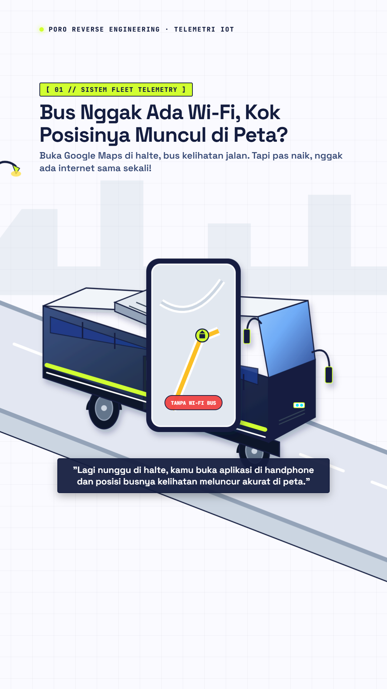 | 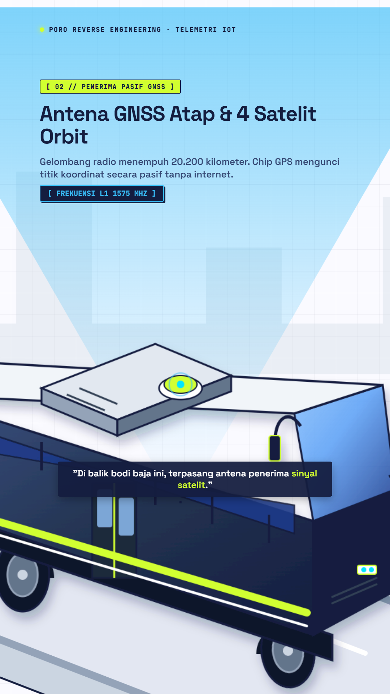 | 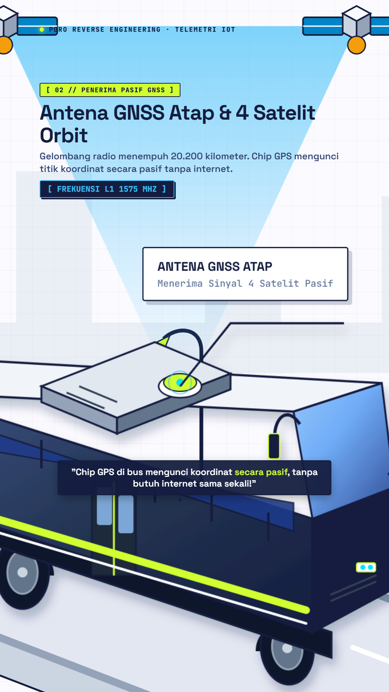 |
| *Passenger check on Google Maps + continuous highway loop* | *Macro zoom into rooftop HVAC & passive GNSS puck* | *Live SVG leader line pointing to antenna* |

| 04. Cutaway IoT & BTS | 05. 3-Beat Metric Punch |
| :---: | :---: |
| 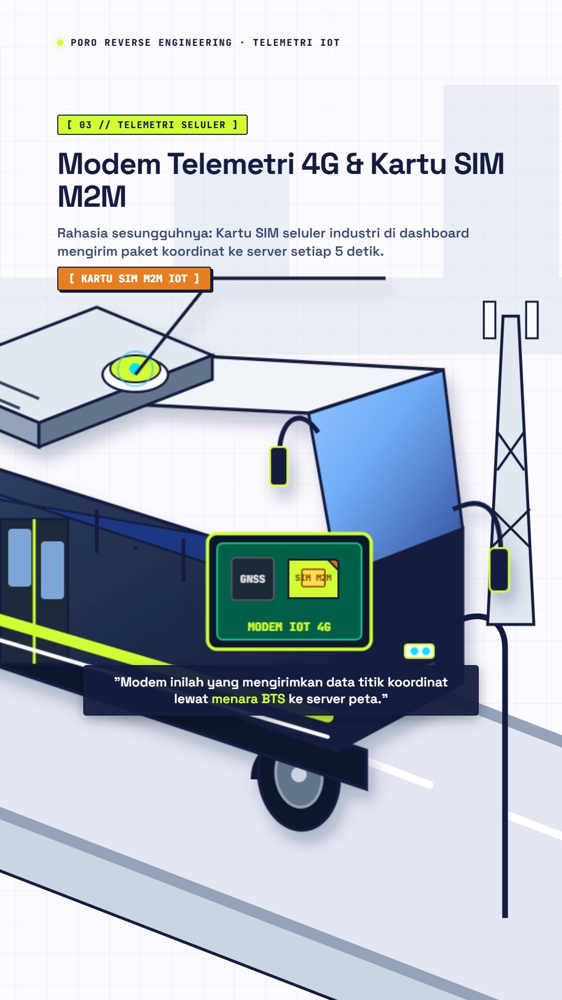 | 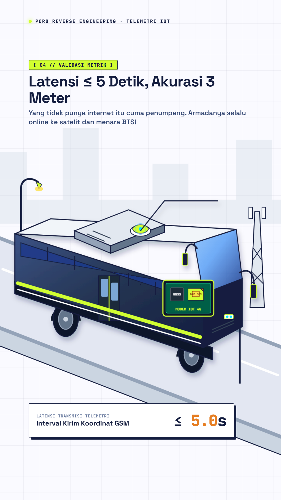 |
| *Dashboard cutaway revealing 4G Modem & M2M SIM* | *Sub-drop foley + scale-pop latency proof* |

* 🌐 **Interactive Master Deliverable:** [`outputs/bus-gps-tracking.html`](outputs/bus-gps-tracking.html) (add `?debug=1` for interactive scrubber, frame seeker, audio toggle, and safe-zone overlay).
* 📐 **Starter Base Template:** [`templates/starter-poro-9x16.html`](templates/starter-poro-9x16.html).
* 🎙️ **Multi-Engine Voiceover Generator:** [`scripts/generate_vo.py`](scripts/generate_vo.py) (ElevenLabs, Gemini 2.0 Audio, Edge-TTS).

---

## 🎬 Engine 1: 3D Semi-Real Explainer (Blender EEVEE Next)

Below are actual uncompressed master frames rendered via Blender EEVEE Next and composited with pure VOLT Design System 1.1 overlays:

| 01. The Horizon Hook (Hero) | 02. The Orbit Slice (Peeled Wall) | 03. The Whip-Punch (Vacuum Gap) |
| :---: | :---: | :---: |
| 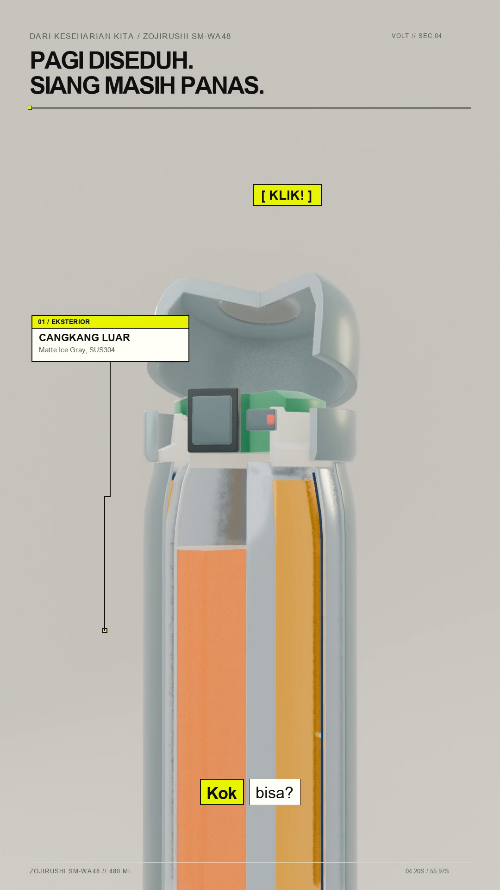 | 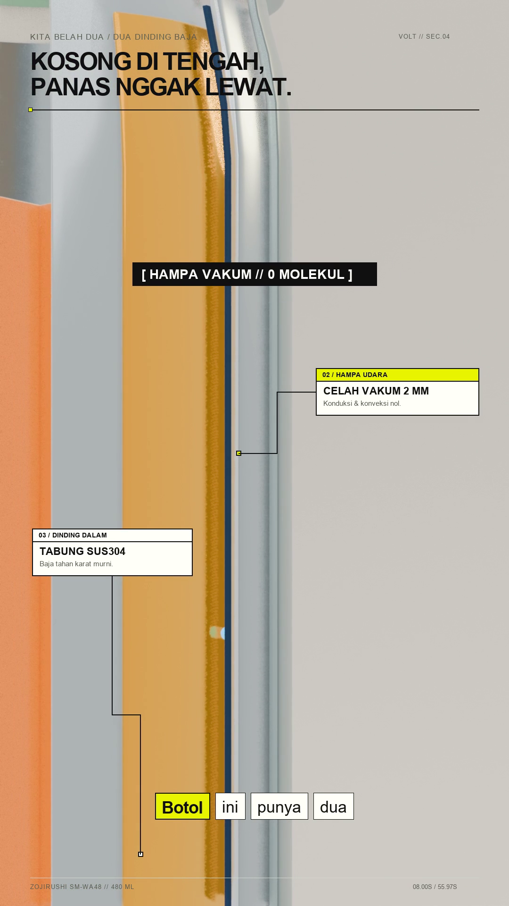 | 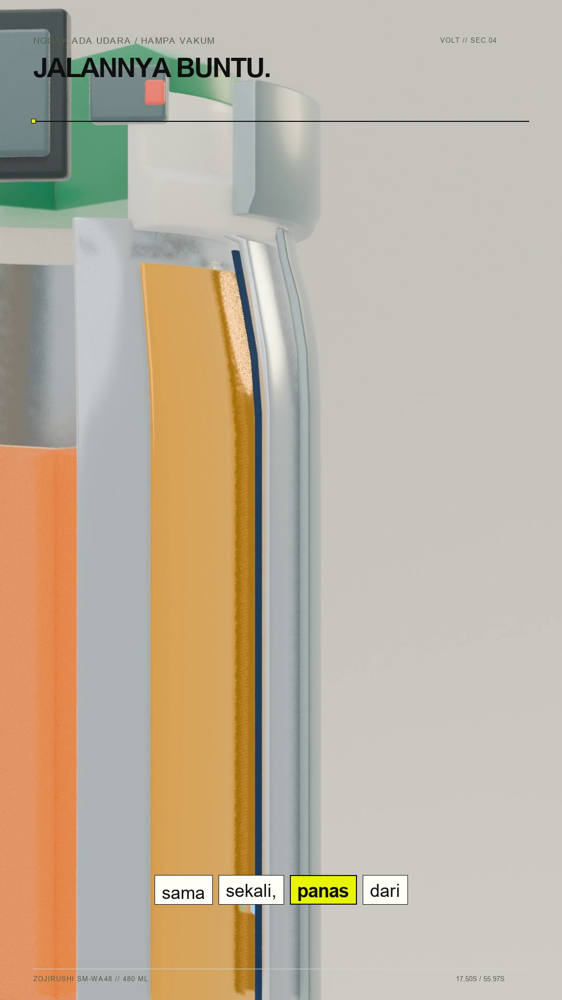 |
| *Smooth crane rise on cyclorama `#F4F1EA`* | *3D solid wall bevels with rim speculars* | *Speed ramp whip into 1mm double-wall gap* |

| 04. Radiation Wave (Thermal Bounce) | 05. Dynamic Dutch (Exploded Stopper) | 06. Telemetry Lock (Metric Proof) |
| :---: | :---: | :---: |
| 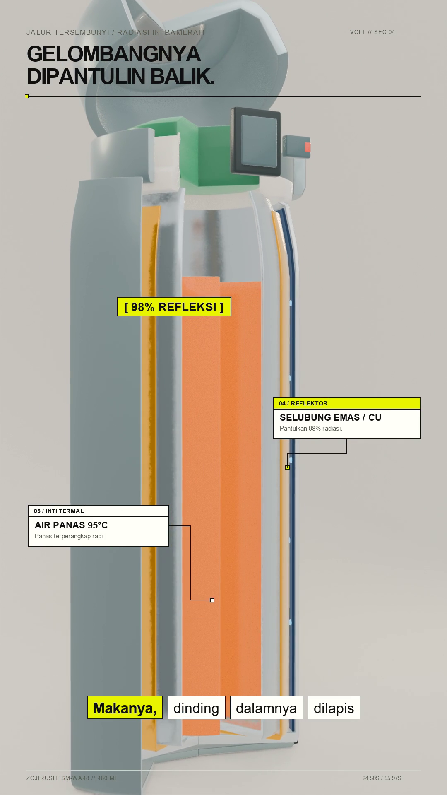 | 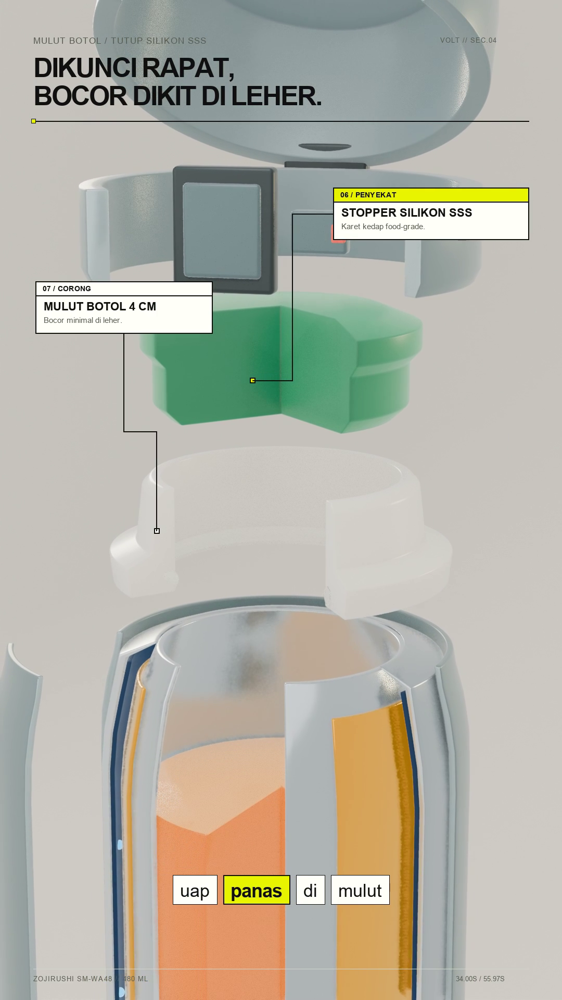 | 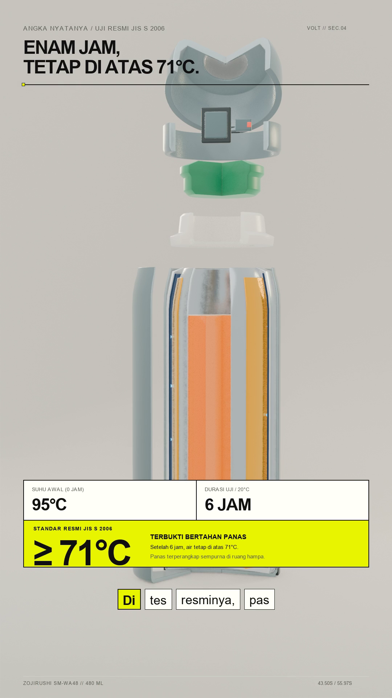 |
| *Active thermal ray emission and bounce* | *High-angle $45^\circ$ Dutch macro on gaskets* | *Dead-steady telemetry lock + 3-beat metric pop* |

| 07. Snap-Out Recoil (Seamless Loop) |
| :---: |
| 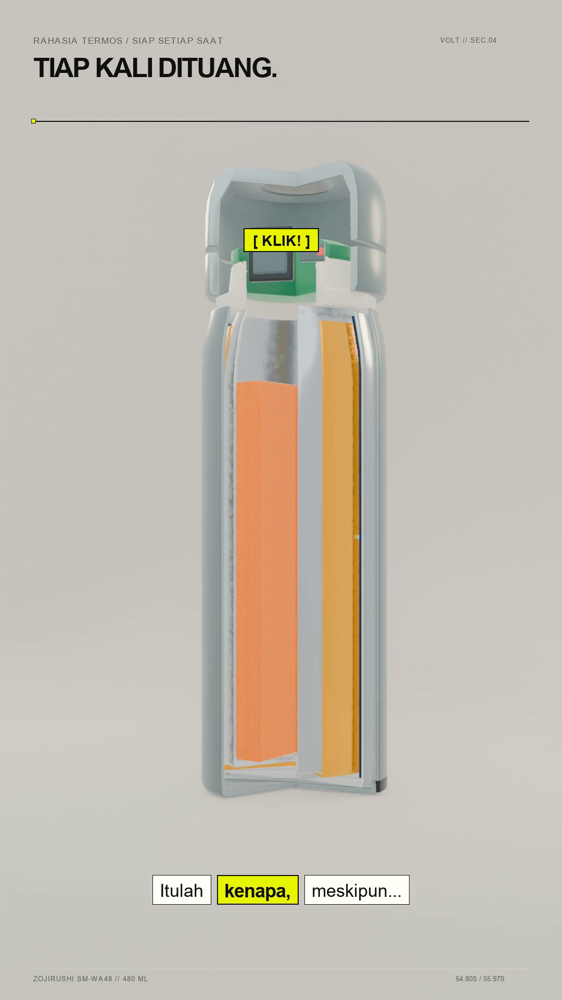 |
| *Fast recoil pull-out matching frame 0000* |

🎥 **Master Video File:** [`outputs/termos-06-animasi-master-semi-realis-v0.4.mp4`](outputs/termos-06-animasi-master-semi-realis-v0.4.mp4) (19.6 MB, H.264 High Profile, AAC 192 kbps, duration $55{,}97\text{s}$).

---

## 💡 Core Philosophy & Directives

This framework eliminates the monotonous "2D slide-show" feel of typical AI-generated videos by enforcing **true 3D sequential rendering** and **tactile industrial design language**:

1. **NO 2D Pans / Zooms:** Every shot is generated from true 3D camera travel ($X, Y, Z$), focal morphing, and active physical component deconstruction.
2. **Semi-Realistic Aesthetic (Clean Tactile Engineering):**
   - **NO Cartoon Freestyle Outlines:** Strictly zero black ink cartoon strokes.
   - **Closed Solid Manifolds:** Authentic wall thickness with $0{,}3\text{–}1{,}2\text{ mm}$ edge bevels catching specular highlights.
   - **Tactile PBR Materials:** Anodized powder-coat, brushed SUS304 stainless steel, specular mirrors, and Subsurface Scattering (SSS) on elastomeric silicone seals.
   - **Curved Cyclorama:** Warm-white (`#F4F1EA`) infinity cove with 3-point studio lighting and dual rim lights.
3. **VOLT Design System 1.1:**
   - **Typography:** Arial / Helvetica Bold with tight tracking (`-0.055em` to `-0.065em`) and line-height `0.95`.
   - **Modular Grid:** Crisp $1.5\text{–}2.0\text{ px}$ `#101110` solid borders, zero corner radius ($0\text{ px}$ sharp corners).
   - **The One Signal Principle:** Only the active component receiving voiceover focus turns `#E8F500` (*Electric Yellow*); secondary elements remain `#FFFFFA` (*Paper*).
   - **Zero Visual Noise:** NO artificial black drop shadows or multi-colored decorative ribbons.

---

## 🏛️ Framework Architecture

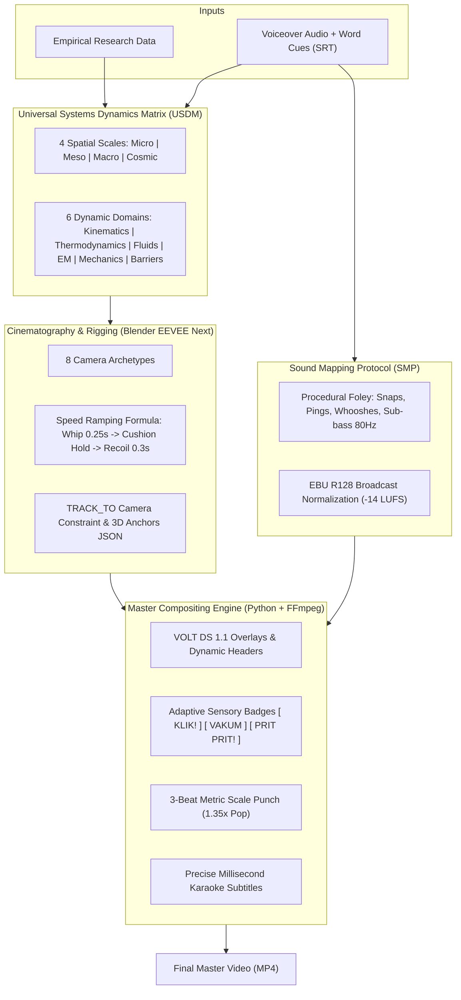

### 1. Universal Systems Dynamics Matrix (USDM)
Maps any technical or physical subject across 4 spatial scales and 6 dynamic domains:
- **Micro / Nano:** Heat radiation waves, battery ion transfer, semiconductor logic gates.
- **Meso:** Consumer hardware, thermoses, mechanical watch movements, automotive brakes.
- **Macro:** Tuned mass dampers in skyscrapers, suspension bridge load vectors.
- **Cosmic:** Earth $23.5^\circ$ axial tilt, seasonal sunlight radiation angles, orbital mechanics.

### 2. The 8 Cinematic Camera Archetypes
| No | Archetype Name | Narrative Purpose | Lens & Easing |
| :---: | :--- | :--- | :--- |
| **01** | **The Horizon Hook** | Hero introduction on cyclorama | $35\text{–}50\text{ mm}$, smooth crane rise |
| **02** | **The Whip-Punch** | Directs viewer gaze into microscopic flaws | $85\text{–}100\text{ mm}$ macro, $0.25\text{s}$ whip entrance |
| **03** | **The Orbit Slice** | Revealing interior wall cross-sections | $30^\circ\text{–}45^\circ$ continuous rotational sweep |
| **04** | **The Micro-Dolly** | Inspecting micro channels & gaskets | Narrow macro, steady tracking velocity |
| **05** | **The Tunneling** | Plunging inside cavities or fluid orifices | Longitudinal travel with deceleration |
| **06** | **The Dynamic Dutch** | Mechanical snap, explosion, shock wave | High-angle $45^\circ$ macro + $12^\circ$ Dutch tilt |
| **07** | **The Telemetry Lock** | Metric data proof verification | **100% Dead Steady (zero drift)** on right third |
| **08** | **The Snap-Out Recoil**| Outro seamless loop return | $0.35\text{s}$ fast recoil matching Frame 0000 |

### 3. Adaptive Semantic Sensory Typography
Dynamic contextual badges reflecting sensory events:
- **Mechanical:** `[ KLIK! ]`, `[ SNAP ]`, `[ KUNCI RAPAT ]` (Electric yellow `#E8F500` box, spring scale pop $1.35\times \rightarrow 1.0\times$).
- **Physics / Telemetry:** `[ HAMPA VAKUM // 0 MOLEKUL ]`, `[ 98% REFLEKSI ]` (Black `#101110` box, implosion squeeze).
- **Everyday & Domestic:** `[ PRIT PRIT! ]`, `[ TIIIN! ]`, `[ BLEBEK-BLEBEK! ]` (Staccato double-pulse vibration).
- **Digital / Interface:** `[ TRING! ]`, `[ 1 PESAN MASUK ]` (Top-edge spring pop).

### 4. Sound Mapping Protocol & Loudness Standard
- **Voiceover (VO):** Center lead, crystal clarity.
- **Procedural Foley ($-12\text{ dB}$):** Mechanical clicks, pneumatic whooshes, metal pings, whistles.
- **Sub-Bass Impact ($-14\text{ dB}$):** $75\text{–}85\text{ Hz}$ sine drop emphasizing key test metrics.
- **EBU R128 Normalization:** Always use FFmpeg `normalize=0:dropout_transition=0` with `loudnorm=I=-14:TP=-1.0:LRA=7` to achieve broadcast compliance without VO attenuation.

---

## 🤖 AI Model Compatibility & Roles

| Model | Recommended Pipeline Role | Key Strengths |
| :--- | :--- | :--- |
| **Claude 3.5 Sonnet / Claude Code** | **Cinematography Director & Sensory Copywriter** | Unrivaled narrative cadence, spatial metaphor reasoning, and sensory copywriting. |
| **OpenAI GPT-4o / Codex** | **Computational Rigging & Systems Engineer** | Precision mathematical vector calculations (`mathutils`), complex procedural audio synthesis, and FFmpeg filtergraphs. |
| **Google Gemini 1.5/2.0 Pro / Antigravity** | **Autonomous Multimodal Lead Producer** | Massive 1M+ token context window, visual frame inspection, and native tool execution for end-to-end delivery. |
| **DeepSeek-V3 / Qwen 2.5 Coder** | **Headless Batch Execution Assistant** | Fast deterministic script execution for offline local render farms. |

👉 For full instructions and prompt templates, see [`docs/PANDUAN_PENGGUNAAN_DAN_KOMPATIBILITAS_AI.md`](docs/PANDUAN_PENGGUNAAN_DAN_KOMPATIBILITAS_AI.md).

---

## 📁 Repository Structure

```
├── .agent/
│   └── skills/
│       └── 3d-semi-real-explainer/
│           └── SKILL.md                 # Universal Agent Skill definition
├── docs/
│   ├── PANDUAN_PENGGUNAAN_DAN_KOMPATIBILITAS_AI.md  # Comprehensive AI User Guide
│   └── assets/                          # Showcase master keyframe images
├── outputs/
│   ├── guideline-render-3d-semi-realis-v0.2.md       # Master production guideline
│   ├── termos-03-animated-semi-realis-v0.4.blend     # Master 3D Blender scene
│   ├── termos-04-master-audio-v0.4.mp3               # EBU R128 normalized master audio
│   ├── termos-05-anim-anchors-v0.4.json              # 3D-to-2D tracking coordinates
│   └── termos-06-animasi-master-semi-realis-v0.4.mp4 # Final composited master video
├── work/
│   ├── fonts/                           # Production typography
│   ├── termos-3d/
│   │   ├── build_semi_realistic_v03.py  # 3D solid geometry generator
│   │   ├── animate_rig_v04.py           # 8-archetype camera & part animator
│   │   ├── build_soundtrack_v04.py      # Procedural foley & audio mixer
│   │   └── assemble_master_video_v04.py # Final PIL & FFmpeg compositing script
│   └── tests/                           # Benchmark & validation scripts
├── .gitignore                           # Excludes multi-GB frame sequences
└── README.md
```

---

## 🚀 Quick Start & Reproduction

### Prerequisites
- Blender 4.2+ or 5.x LTS in `PATH`
- Python 3.10+ (`pip install pillow numpy scipy`)
- FFmpeg 6.0+ in `PATH`

### Step-by-Step Reproduction
```bash
# 1. Generate 3D Solid Geometry
blender -b -P work/termos-3d/build_semi_realistic_v03.py

# 2. Animate Rig & Export 3D Tracking Anchors
blender outputs/termos-03-master-semi-realis-v0.3.blend -b -P work/termos-3d/animate_rig_v04.py

# 3. Render Sequential 3D Frames (EEVEE Next, 1680 frames)
blender outputs/termos-03-animated-semi-realis-v0.4.blend -b -s 0 -e 1679 -a

# 4. Generate Procedural Foley & Master Audio (-14 LUFS)
python work/termos-3d/build_soundtrack_v04.py

# 5. Composite Final Master Video
python work/termos-3d/assemble_master_video_v04.py
```

---

## 📄 License & Credits
Licensed under the [MIT License](LICENSE).  
Created as a repeatable standard for high-fidelity technical explainer motion graphics.
