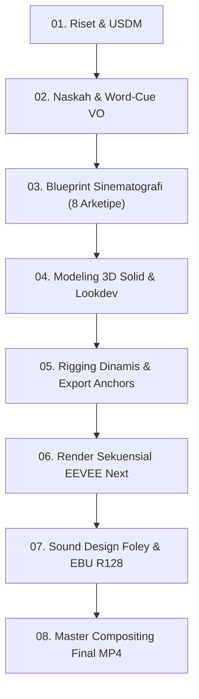

# Panduan Penggunaan Skill & Kompatibilitas AI
## Framework Produksi Video Motion Graphic 3D Semi-Realis (VOLT DS 1.1)

Dokumen ini merupakan panduan operasional lengkap untuk menggunakan Skill **`3d-semi-real-explainer`**. Panduan ini mencakup analisis kompatibilitas model kecerdasan buatan (AI), arsitektur alur kerja lintas model, persyaratan sistem, dan template prompt instruksi untuk memproduksi video eksplanasi teknis vertikal 3D berkualitas industri dari nol.

---

## 1. Kompatibilitas Model AI & Pembagian Peran

Framework ini dirancang agnostik model, namun setiap AI model memiliki spesialisasi dan keunggulan kognitif tersendiri. Rekomendasi pembagian peran (*orchestration matrix*):

| Model AI | Peran Ideal dalam Pipeline | Kekuatan Utama | Catatan Penggunaan |
| :--- | :--- | :--- | :--- |
| **Claude 3.5 Sonnet / Claude Code** | **Skenario, Sinematografi & Sensori** | • Pemahaman konteks narasi dan ritme emosional tingkat tinggi.<br>• Sensitivitas tipografi sensori & pemilihan onomatopoeia kontekstual.<br>• Perencanaan *storyboard* 8 arketipe kamera yang dinamis. | Sangat optimal untuk Tahap 1 (Riset & USDM), Tahap 2 (Naskah & Word-Cue), dan Tahap 3 (Blueprint Kamera). |
| **OpenAI GPT-4o / Codex** | **Rekayasa Komputasi & Scripting 3D/Audio** | • Ketepatan tinggi dalam kalkulasi vektor `mathutils` Blender.<br>• Pembuatan skrip prosedural Python sintesis audio foley (`scipy.signal`).<br>• Keahlian filtergraph kompleks FFmpeg. | Sangat optimal untuk Tahap 4 & 5 (Skrip Rigging 3D, Tracking Anchors JSON) dan Tahap 7 (Sintesis Audio & Mastering). |
| **Google Gemini 1.5/2.0 Pro / Antigravity** | **Orkestrator Multimodal Otonom (End-to-End)** | • Context window masif (1M+ token) yang mampu membaca seluruh aset kode & data sekaligus.<br>• Inspeksi visual multimodal (mampu memeriksa frame PNG renderan untuk mendeteksi *artifact* lampu atau kamera *meleset*).<br>• Integrasi *tool execution* (menjalankan Blender, Python, FFmpeg di latar belakang). | Sangat optimal sebagai **Lead Producer Agent** yang menggerakkan seluruh pipeline dari riset hingga render video final. |
| **DeepSeek-V3 / Qwen 2.5 Coder (Lokal)** | **Eksekutor Skrip Batch & Renderer Headless** | • Efisiensi tinggi pada eksekusi kode deterministik.<br>• Bebas batas kuota API untuk iterasi komputasi lokal berulang. | Cocok untuk server render lokal atau automasi batch rendering CLI. |

---

## 2. Persyaratan Sistem & Dependensi Perangkat Lunak

Untuk menjalankan pipeline otomasi penuh, workstation atau render node harus memiliki:

1. **Blender 4.2 LTS atau 5.x LTS:**
   - Wajib mendukung render engine **EEVEE Next** (untuk render cepat 1–1.5 detik per frame dengan raytraced shadows).
   - Pastikan binary Blender terdaftar dalam `PATH` sistem atau dapat dipanggil melalui CLI:
     ```bash
     blender -b -P script.py
     ```
2. **FFmpeg 6.0+:**
   - Wajib mendukung filter `amix`, `loudnorm`, `scale`, `drawtext`, dan encoder `libx264` + `aac`.
3. **Python 3.10+ Environment:**
   - Library yang dibutuhkan:
     ```bash
     pip install pillow numpy scipy
     ```
4. **Tipografi (Fonts):**
   - **Utama:** `Arial Bold` / `Helvetica Bold` (font sistem baku).
   - **Alternatif Modern:** `PlusJakartaSans-Bold.ttf` (disediakan di `work/fonts/`).

---

## 3. Cara Mengaktifkan & Menggunakan Skill

### A. Lokasi File Skill
- **Level Workspace:** `.agent/skills/3d-semi-real-explainer/SKILL.md`
- **Level Global (Antigravity):** `C:\Users\<User>\.gemini\config\skills\3d-semi-real-explainer\SKILL.md`

### B. Memanggil Skill dalam Sesi AI
Cukup sebutkan nama skill atau berikan instruksi bertarget:
> *"Gunakan skill `3d-semi-real-explainer` untuk memproduksi video motion graphic 3D semi-realis vertikal tentang [TOPIK ANDA]. Ikuti seluruh pakem VOLT Design System 1.1, USDM, 8 arketipe kamera, dan standar audio EBU R128."*

---

## 4. Template Prompt Lintas Domain

Gunakan template di bawah ini untuk memulai proyek baru dengan AI:

### Template 1: Perangkat Keras / Mekanikal Konsumen (Meso-Scale)
```markdown
Aktifkan skill 3d-semi-real-explainer.
Tolong buatkan video explainer 3D semi-realis vertikal (9:16, 1080x1920, 30 FPS) untuk:
- Produk: Jam Tangan Mekanik Otomatis (Automatic Watch Movement)
- Poin Kunci yang dijelaskan:
  1. Rotor pemberat yang berputar bebas mengikuti ayunan pergelangan tangan.
  2. Mainspring (pegas utama) yang tergulung dan menyimpan energi potensial.
  3. Escapement wheel dan balance wheel yang berdetak membagi waktu menjadi 28.800 getaran per jam (4 Hz).
  4. Efisiensi daya cadangan (Power Reserve) 40 jam teruji standar horologi.
- Desain & Estetika:
  - Semi-realistis: Material stainless steel 316L brushed, roda gigi kuningan satin, ruby synthetic bearings semi-transparan.
  - Cyclorama studio warm-white (#F4F1EA).
  - Terapkan VOLT Design System 1.1, kinetic badges [ TIK-TOK! ], [ 28.800 VPH ], dan audio mastering -14 LUFS.
```

### Template 2: Rekayasa Sipil & Arsitektur (Macro-Scale)
```markdown
Aktifkan skill 3d-semi-real-explainer.
Tolong buatkan video explainer 3D semi-realis vertikal (9:16, 1080x1920, 30 FPS) untuk:
- Topik: Cara Kerja Tuned Mass Damper (Peredam Gempa & Badai) pada Gedung Taipei 101
- Poin Kunci:
  1. Struktur gedung bergoyang saat diterpa angin topan ekstrem.
  2. Bandul bola baja raksasa seberat 660 ton yang tergantung di lantai 87–92 berayun berlawanan arah.
  3. Peredam hidrolik menyerap energi kinetik ayunan.
  4. Reduksi osilasi gedung hingga 40%.
- Terapkan 8 arketipe kamera (termasuk Dynamic Dutch saat simulasi guncangan gempa dan Telemetry Lock saat menampilkan data uji 40%).
```

### Template 3: Fenomena Kosmik & Sains Alam (Cosmic-Scale)
```markdown
Aktifkan skill 3d-semi-real-explainer.
Tolong buatkan video explainer 3D semi-realis vertikal (9:16, 1080x1920, 30 FPS) untuk:
- Topik: Kenapa Ada 4 Musim di Bumi (Rotasi & Kemiringan Sumbu Bumi)
- Poin Kunci:
  1. Kemiringan sumbu rotasi Bumi 23,5 derajat (bukan orbit elips yang jadi penyebab utama musim).
  2. Perputaran mengelilingi Matahari sepanjang 365,25 hari.
  3. Perbedaan sudut datang radiasi sinar matahari pada belahan Bumi Utara vs Selatan.
  4. Badges kinetik: [ 23.5° TILT ], [ PERIHELION ], [ TITIK BALIK MATAHARI ].
```

### Template 4: Fenomena Jalanan / Akustik Sehari-hari (Domestic & Street Phenomena)
```markdown
Aktifkan skill 3d-semi-real-explainer.
Tolong buatkan video explainer 3D semi-realis vertikal (9:16, 1080x1920, 30 FPS) untuk:
- Topik: Fisika Akustik di Balik Peluit Tukang Parkir (Kenapa Bunyinya Melengking Menusuk Telinga?)
- Poin Kunci:
  1. Udara berkecepatan tinggi ditiupkan ke corong peluit.
  2. Udara menabrak bilah pemecah (fipple), menciptakan turbulensi pusaran pusar (vortex shedding).
  3. Bola gabus kecil di dalam rongga berputar memutus aliran udara secara periodik menghasilkan vibrasi staccato.
  4. Frekuensi resonansi tinggi ~3.000 Hz yang tepat mengenai titik paling sensitif telinga manusia.
- Terapkan Onomatopoeia Kinetik: [ PRIT PRIT! ] dengan double-pulse scale pop dan sound effect foley staccato.
```

---

## 5. Alur Kerja Produksi 8 Langkah (Universal SOP)



1. **Langkah 1: Riset & USDM (Universal Systems Dynamics Matrix)**
   - Tentukan skala: Micro, Meso, Macro, atau Cosmic.
   - Pilih minimal 2 domain dinamika fisik (kinematika, termodinamika, fluida, elektromagnetik, dll.).
2. **Langkah 2: Naskah & Word-Cue VO**
   - Tulis naskah narasi padat berdurasi ~45–60 detik.
   - Buat file `.srt` sinkronisasi kata per kata (milidetik).
3. **Langkah 3: Blueprint Sinematografi & Kinetic Badges**
   - Petakan setiap adegan ke 8 arketipe kamera (Whip-Punch, Orbit Slice, Dynamic Dutch, Telemetry Lock, dll.).
   - Definisikan teks kinetik adaptif (`[ KLIK! ]`, `[ 0 MOLEKUL ]`, `[ PRIT PRIT! ]`).
4. **Langkah 4: Modeling 3D Solid & Material Lookdev**
   - Wajib geometri *solid manifold* dengan bevel $0{,}3\text{–}1{,}2\text{ mm}$ (dilarang permukaan 2D tipis/kertas).
   - Shader semi-realistis: logam, karet/silikon SSS, plastik bertekstur mikro, cyclorama `#F4F1EA`.
5. **Langkah 5: Rigging Dinamis & Speed Ramping**
   - Pasang constraint `TRACK_TO` ke empty target agar kamera selalu mengunci titik fokus.
   - Terapkan rumus speed ramping: *Whip 0.25s $\rightarrow$ Spring Cushion Hold $\rightarrow$ Recoil Exit 0.3s*.
   - Ekspor posisi 3D titik tracking ke file JSON 2D untuk penempatan kartu grafis.
6. **Langkah 6: Render Sekuensial EEVEE Next**
   - Render 1680 frame (30 FPS, 56 detik) ke folder `anim_frames/`. Target waktu $\le 1.5$ detik per frame.
7. **Langkah 7: Sound Design Foley & Loudness Mastering**
   - Sintesiskan efek suara mekanis, hampa udara, denting logam, dan sub-bass drop $80\text{ Hz}$.
   - Gabungkan dengan VO menggunakan FFmpeg `amix=inputs=X:normalize=0`.
   - Normalisasi ke **$-14\text{ LUFS}$** broadcast standard (`loudnorm=I=-14:TP=-1.0:LRA=7`).
8. **Langkah 8: Master Compositing Final MP4**
   - Gabungkan sekuens render dengan overlay VOLT Design System 1.1 (header dinamis, kartu label pegas, 3-beat metric scale punch, subtitle karaoke).
   - Render video master H.264 High Profile / AAC 192 kbps.

---

## 6. Tips Mengatasi Kendala Teknis (Troubleshooting)

1. **Volume Suara / VO Tenggelam Setelah Dimix:**
   - *Penyebab:* Parameter bawaan FFmpeg `amix` membagi gain dengan jumlah input ($1/N$).
   - *Solusi:* Gunakan flag `normalize=0:dropout_transition=0` dan akhiri dengan filter `loudnorm=I=-14:TP=-1.0:LRA=7`.
2. **Kamera 3D Tidak Menghadap Objek Saat Bergeser:**
   - *Penyebab:* Kamera hanya digeser posisinya tanpa constraint rotasi.
   - *Solusi:* Tambahkan constraint `TRACK_TO` pada kamera yang mengarah ke target `GEO_Camera_Focus_Target` dengan `track_axis='TRACK_NEGATIVE_Z'` dan `up_axis='UP_Y'`.
3. **Penyimpanan Git Membengkak:**
   - *Penyebab:* File PNG renderan sekuensial (1680 frame $\approx 3.5\text{ GB}$) ikut ter-track git.
   - *Solusi:* Pastikan `.gitignore` mencantumkan `anim_frames/`, `anim_frames_*/`, dan `*.blend1`. Video master `.mp4` ($<100\text{ MB}$) tetap aman untuk di-commit.
