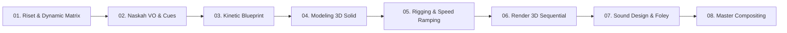

# Panduan Universal: Produksi Video Eksplanasi 3D Semi-Realis & VOLT Design System (v0.2)

Dokumen ini adalah **Standar Operasional Prosedur (SOP), Pakem Arsitektur, dan Manual Rekayasa Kreatif** untuk memproduksi video eksplanasi teknis vertikal (9:16, $1080 \times 1920$, 30 FPS) secara otomatis, terukur, dan konsisten menggunakan kecerdasan buatan (AI).

SOP ini dirancang **Universal**: berlaku sama kuatnya untuk produk konsumen (*meso*), komponen mikro/elektronika (*mikro*), infrastruktur dan konstruksi sipil (*makro*), hingga fenomena astrofisika dan tata surya (*kosmik*), serta mencakup situasi kehidupan nyata (akustik jalanan, dapur domestik, antarmuka digital).

---

## 1. Filosofi & Kontrak Desain Utama

1. **Murni 3D Sequential (Anti-Pan/Zoom 2D):**
   - Video eksplanasi 3D **dilarang keras** dibuat dari gambar diam (still render) yang digeser atau di-zoom secara 2D.
   - Seluruh adegan harus dihasilkan dari pergerakan kamera 3D nyata ($X, Y, Z$), perputaran fokal, perubahan sudut pandang, dan dekonstruksi fisik dinamis per frame.
2. **Estetika 3D Semi-Realis (Tactile Clean Engineering):**
   - **Bebas Garis Kartun:** Dilarang menggunakan outline hitam tebal gaya *Freestyle Cartoon* ($2\text{ px}$ black stroke).
   - **Material Fisik Solid:** Setiap potongan memiliki ketebalan dinding nyata (*closed manifold solid*), sudut siku dihaluskan (*micro-beveling* $0{,}3\text{–}1{,}2\text{ mm}$) untuk menangkap pantulan cahaya (*specular highlight*), dan material organik/karet menggunakan *Subsurface Scattering (SSS)*.
   - **Pencahayaan Studio Bersih:** Tiga titik cahaya (*Key, Fill, Back*) + *Dual Strong Rim Light* + *Curved Infinity Cyclorama* putih-hangat (`#F4F1EA`) tanpa garis potong cakrawala yang mengganggu.
3. **Pure VOLT Design System 1.1:**
   - **Tipografi:** True Arial / Helvetica Bold dengan *tight tracking* (`-0.055em` s/d `-0.065em`) dan spasi vertikal rapat.
   - **Grid Modular & Sudut Tegak:** Border tegas `1.5px–2px solid #101110`, radius sudut $0\text{ px}$ (siku mutlak), dan **dilarang memakai artificial drop-shadow atau pita warna-warni**.
   - **The One Signal Principle:** Dalam satu adegan, hanya 1 komponen/data utama yang sedang dibahas yang disorot dengan blok warna kuning `#E8F500` (*Electric Yellow*). Elemen pendamping tetap netral di `#FFFFFA` (*Paper*).

---

## 2. Universal Systems Dynamics Matrix (USDM)

> [!IMPORTANT]
> **Kaidah Wajib Tahap Riset (Tahap 1 & 3):**
> AI dilarang melanjutkan ke tahap pemodelan 3D sebelum melakukan audit terhadap **Skala Spasial** dan **6 Domain Dinamika Fisik**. Objek tidak boleh dipandang sebagai benda mati statis.

### A. 4 Skala Spasial Semesta (The 4 Spatial Scales)
1. **Skala Mikro/Nano:** Molekul, elektron, pori-pori mikron, radiasi termal $\rightarrow$ visualisasi via partikel emitter terarah dan perjalanan lorong (*tunneling*).
2. **Skala Meso (Produk Konsumen):** Termos, jam tangan, smartphone, mesin perkakas $\rightarrow$ visualisasi via *cross-section cut*, kelupasan radial, dan *axial exploded*.
3. **Skala Makro (Konstruksi & Struktur):** Gedung pencakar langit, jembatan, pabrik, lalu lintas $\rightarrow$ visualisasi via perakitan modular bertingkat (*layer assembly*) + panah vektor beban gaya statika dan pendulum peredam gempa (*tuned mass damper*).
4. **Skala Kosmik (Astrofisika):** Bumi, orbit matahari, gravitasi planet $\rightarrow$ visualisasi via garis poros kemiringan (inklinasi $23{,}5^\circ$), jejak elips orbit revolusi, dan garis terminator cahaya siang/malam.

### B. Taksonomi 6 Domain Dinamika Fisik (Physical Behavior Matrix)
AI wajib mengisi minimal 2 dari 6 domain ini sebagai daftar aset visual yang bergerak aktif:
1. **Kinematika & Mekanikal:** Komponen yang berputar pada poros, bergeser linear, pegas yang membal, engsel yang membuka, atau ulir yang mengencang.
2. **Termodinamika & Kalor:** Gelombang radiasi inframerah yang memancar, sirkulasi konveksi fluida, atau konduksi getaran partikel.
3. **Dinamika Fluida & Gas:** Aliran laminar vs turbulen, hisapan ruang hampa vakum, letupan gelembung didih, atau perbedaan tekanan ($P_1 > P_2$).
4. **Elektromagnetik & Sirkuit:** Aliran drift elektron, garis medan fluks magnetik, emisi foton LED, atau radiasi gelombang frekuensi radio.
5. **Mekanika Material & Seal:** Karet silikon yang tertekan/memampat (*compression*), regangan elastisitas, gesekan kampas rem, atau keausan permukaan.
6. **Penghalang & Refleksi (Barrier & Rebound):** Pantulan gelombang oleh cermin logam, penyaringan partikel oleh filter membran, atau penahan kebocoran.

---

## 3. Katalog 8 Arketipe Sinematografi 3D & Speed Ramping

Dilarang menggerakkan kamera secara linier atau melakukan *lazy continuous drift*. Setiap shot harus memiliki arketipe dan kurva kecepatan:

| Arketipe Kamera | Fungsi Naratif | Karakter Sudut & Lensa | Formula Speed Ramping |
| :--- | :--- | :--- | :--- |
| **01. The Horizon Hook** | **Pembuka / Skala Total:** Mengenalkan wibawa objek pertama kali. | Low angle mendongak ($15^\circ\text{–}20^\circ$) naik meluncur ke eye level (*crane up*). Lensa $35\text{–}50\text{ mm}$. | `ease_in_out` anggun ($0.0\text{s} - 5.0\text{s}$). |
| **02. The Whip-Punch** | **Transisi Masalah:** Menarik perhatian mendadak ke titik bedah. | Pergeseran cepat ke celah/komponen spesifik. Lensa zoom $50\text{–}85\text{ mm}$. | *Fast whip* ($0{,}2\text{s}$) $\rightarrow$ *Cushion hold* ($1{,}5\text{s}$) dengan spring damping. |
| **03. The Orbit Slice** | **Pembelahan Objek:** Memperlihatkan kedalaman & volume 3D saat dibelah. | Rotasi $30^\circ\text{–}60^\circ$ mengelilingi bidang iris interior. | Rotasi bertahap mendalam saat cangkang terpisah. |
| **04. The Micro-Dolly** | **Inspeksi Celah Mikro:** Menelusuri kerapatan seal, celah vakum, ulir. | Lensa makro sempit ($85\text{–}105\text{ mm}$), DOF tipis. Bergerak lurus sejajar celah. | Gerak lambat stabil (*constant precision tracking*). |
| **05. The Tunneling** | **Penetrasi Internal:** Masuk ke dalam lorong, pipa, rongga cairan, atau silinder. | Kamera meluncur menembus mulut corong/lubang ke dalam interior. | Akselerasi masuk $\rightarrow$ perlambatan di rongga utama. |
| **06. The Dynamic Dutch** | **Aksi / Benturan Mekanik:** Momen pegas membal, fluida memancar, gelombang mantul. | Kamera dimiringkan $10^\circ\text{–}15^\circ$ (*Dutch tilt*) dengan mikro guncangan ($0{,}05\text{s}$). | Entakan kinetik sinkron dengan benturan fisik. |
| **07. The Telemetry Lock** | **Penyajian Bukti Data:** Pembacaan kartu metrik dan angka riset. | Kamera terkunci **100% statis absolut (zero wobble)**. | Statis total untuk menjamin keterbacaan data. |
| **08. The Snap-Out Recoil** | **Outro Penutup:** Objek kembali utuh dan siap mengulang loop video. | Kamera ditarik mundur kencang (*pull-out snap* $0{,}35\text{s}$). | Tarikan cepat sinkron dengan komponen yang mengunci. |

---

## 4. Engine Teks Kinetik Adaptif & Onomatopoeia

Teks penekanan tidak boleh kaku atau terbatas pada contoh pabrik. AI menggunakan **Algoritma 3 Sumbu Penurunan Sensorik**:
1. **Modalitas Indera:** Deteksi apakah narasi membahas *Akustik* (suara), *Mekanik* (gaya fisik), *Termal* (suhu), atau *Digital* (antarmuka).
2. **Intensitas Emosi:** Staccato (singkat-tajam), Crescendo (memuncak), atau Implosif (senyap mendadak).
3. **Konteks Organik:** AI bebas menurunkan kata penekanan sesuai tema:
   * *Mekanikal:* `[ KLIK! ]`, `[ SNAP ]`, `[ KUNCI RAPAT ]`.
   * *Akustik Jalanan / Keseharian:* `[ PRIT PRIT! ]`, `[ TIIIN! ]`.
   * *Dapur & Fluida:* `[ BLEBEK-BLEBEK! ]`, `[ NGIIIIING! ]`, `[ 100°C DIDIH ]`.
   * *Digital / Gadget:* `[ TRING! ]`, `[ SYNCED ]`, `[ 1 PESAN MASUK ]`.
   * *Sains Telemetri:* `[ HAMPA VAKUM ]`, `[ 98% PANTUL ]`, `[ 0 MOLEKUL ]`.

---

## 5. Protokol Anotasi Label (Otonomi Kreatif & Pakem Gerak)

* **Aturan Otonomi (Kondisional):**
  Label pin anotasi **bukan kewajiban** di setiap detik. AI berhak menonaktifkan label jika adegan menuntut visual bersih tanpa gangguan teks (*zero visual clutter*).
* **Pakem Mutlak Jika Label Digunakan:**
  1. *Leader Line Draw ($0{,}15\text{s}$ / 5 frame):* Garis siku menggambar keluar dari titik jangkar objek 3D ke kotak teks.
  2. *Box Spring Pop ($0{,}20\text{s}$ / 6 frame):* Kotak meletup dengan rumus fisika pegas (`scale 0.85 -> 1.08 -> 1.0`).
  3. *One Signal Highlight:* Komponen aktif menyala `#E8F500`, komponen pasif `#FFFFFA`.
  4. *Zero Drop Shadow:* Sudut tegas $0\text{ px}$, garis border tegas $1.5\text{–}2\text{ px}$.

---

## 6. Sound Mapping Protocol (SMP) & Desain Tata Suara

AI memindai naskah VO untuk mengekstrak verba aksi dan menyusun 3 lapisan audio:
* **Foley Physical Layer (Level $-12\text{ dB}$):** Suara mekanik fisik (klik tutup, gesekan logam, hembusan uap, peluit).
* **Atmospheric Layer (Level $-16\text{ dB}$):** Dengung hisapan vakum, hembusan angin, resonansi frekuensi tinggi pantulan radiasi (*ping shimmer*).
* **UI & Impact Sub-Hit Layer (Level $-14\text{ dB}$):** Dentuman sub-bass rendah (75–85 Hz) saat data metrik utama meletup di layar.
* **Master VO Balance:** Suara narasi tetap dominan di $-6\text{ dBFS}$ jernih di atas sound effects.

---

## 7. Standar Animasi Data Metrik Riset (The 3-Beat Metric Punch)

Data riset dari Tahap 1 adalah klimaks pembuktian video explainer. Format animasinya:
1. **Beat 1 - Entrance Pegas ($0{,}2\text{s}$):** Kotak metrik 3-grid meluncur masuk dari bawah dengan hentakan elastis.
2. **Beat 2 - Digit Scale Punch ($0{,}4\text{s}$):** Angka pembuktian (misal: `≥71°C`) membesar $1{,}35\times$ lalu mengendap kembali ke ukuran normal tepat saat narator mengucapkannya.
3. **Beat 3 - Signal Pulse ($0{,}1\text{s}$):** Border kuning `#E8F500` berkedip/berdenyut satu kali bersamaan dengan efek audio konfirmasi digital.

---

## 8. Alur Produksi Terpadu 8 Langkah (Production Pipeline)

1. **Tahap 01 (Riset & USDM):** Ekstraksi spesifikasi dimensi fisik 1:1, data metrik uji resmi, dan analisis 6 Domain Dinamika Fisik.
2. **Tahap 02 (Naskah VO & Audio Cues):** Produksi suara master dan sinkronisasi kata per milidetik (SRT cue).
3. **Tahap 03 (Kinetic Blueprint & Storyboard):** Pemetaan 8 Arketipe Kamera, penetapan label aktif/kondisional, dan onomatopoeia kontekstual.
4. **Tahap 04 (Modeling 3D Semi-Realis):** Pembuatan geometri closed-manifold dengan ketebalan nyata, SSS silikon, dan cyclorama studio tanpa horison.
5. **Tahap 05 (Rigging & Speed Ramping 3D):** Animasi kamera $X, Y, Z$ dengan kurva kecepatan agresif, partikel aktif, dan ekspor koordinat tracking 3D-ke-2D.
6. **Tahap 06 (Render 3D Sequential):** Render seluruh frame berurutan via Blender EEVEE Next (target $\le 1{,}5\text{s}$ per frame).
7. **Tahap 07 (Sound Design & Foley Synthesis):** Sintesis efek suara mekanik/lingkungan dan mixing dengan master VO sesuai kaidah desibel.
8. **Tahap 08 (Master Compositing VOLT DS):** Penggabungan sekuens frame 3D, header dinamis humanizer, badge sensorik, kartu metrik 3-beat, dan subtitle karaoke aktif ke format MP4 H.264/AAC.
